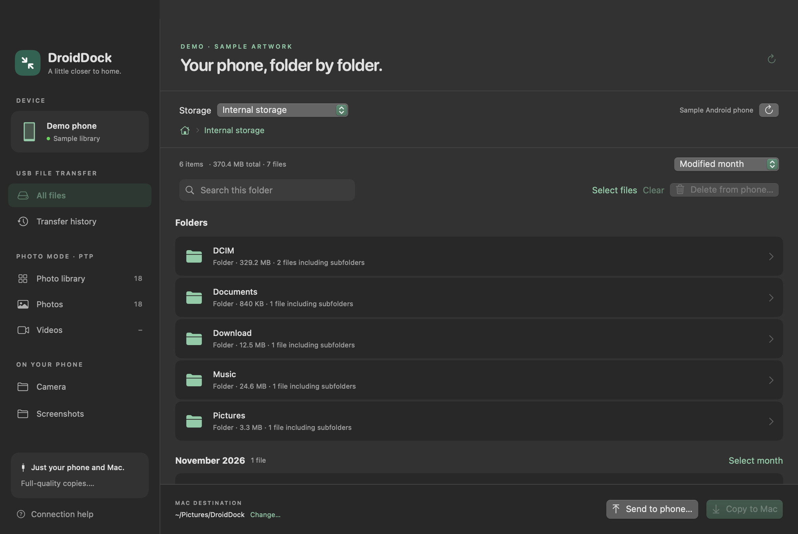
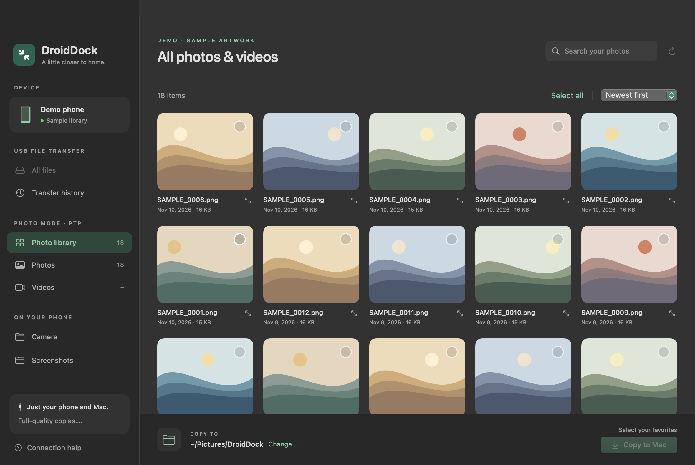
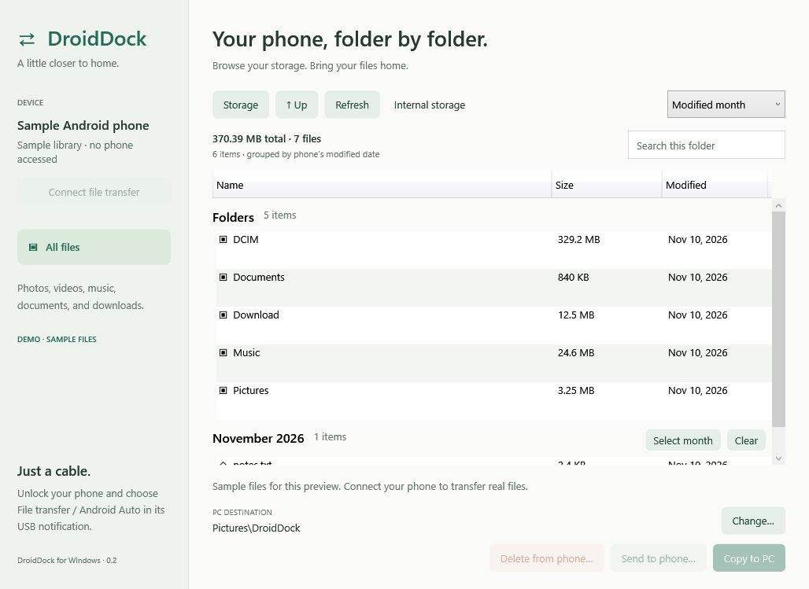

# DroidDock

**Your Android files, a little closer to home.**

A native USB file-transfer app for **macOS and Windows**. Browse your phone, see
folder sizes, group files by month, copy content in either direction, and delete
selected files from your phone. Works with Android's standard **File transfer / MTP** mode, including
phones running OxygenOS 14. No phone companion app, account, Wi-Fi, or USB debugging
required.

[Download builds](https://github.com/sayantan94/DroidDock/releases) ·
[Build status](https://github.com/sayantan94/DroidDock/actions/workflows/build.yml)



*The real Mac app showing labelled sample data. Folder sizes include nested files.*

## What it does

- Browse shared phone storage and search the open folder.
- Group **all file types by modified month and year**, newest first. Use **Select month**
  to select the files shown in a group, then copy or delete them together. Folders
  stay separate, and files without a date appear under **Unknown date**.
- **Delete selected files from the phone** after reviewing a confirmation listing
  every filename. Deletion is permanent; there is no Trash or undo in DroidDock.
  Files already copied to your computer are kept.
- Show the **total size of the open folder and each subfolder**, including nested
  files. Sizes are calculated from metadata; the app does not download files to
  measure them. Navigation and transfers cancel background scans.
- Copy selected files to your computer, or send files into the open phone folder.
- Preserve existing files by adding numbered suffixes to duplicate names.
- Verify downloaded byte counts before moving temporary files into place; verify
  the size reported by the phone after uploads.
- Stop a transfer queue after the current file finishes.

The Mac app also offers an optional PTP photo library with thumbnails, previews,
album filters, and local download history.

## Connect your phone

1. Connect one Android phone using a USB cable that supports data.
2. Unlock it and open its USB notification.
3. Choose **File transfer / Android Auto** and allow file access if prompted.
4. Open DroidDock and click **Connect file transfer**.
5. Open a storage location, then a folder. Select files and choose **Copy to Mac**
   or **Copy to PC**. Use **Send to phone…** to upload files to that folder.

Folder totals include all subfolders regardless of the current search. Large
libraries can take time to scan. If any folder cannot be read, the app shows
**Size unavailable** instead of a misleading partial total; use Refresh to retry.

Monthly groups use the modification date reported by the phone, which may differ
from when a photo was taken. Groups apply to files in the open folder and respect
the current search. Select more than one month to copy or delete those files together.

To delete, use **All files**, select individual files or a month, then choose
**Delete from phone…**. Review the filename list and choose **Delete permanently**.
Cancel is the default. A batch stops on the first error, and folder totals refresh
afterward. **Stop after this file** stops the remaining queued deletions.

For the optional Mac photo library, switch the phone to **Photo transfer / PTP**
and choose **Photo library** in DroidDock.

## Platforms

| | macOS | Windows |
| --- | --- | --- |
| System | macOS 15 or later | Windows 10 / 11, x64 |
| Interface | SwiftUI + AppKit | WPF + .NET 10 |
| File transfer | libmtp + libusb | Windows Portable Devices via MediaDevices |
| Browse, download, upload | Yes | Yes |
| Recursive folder sizes | Yes | Yes |
| Month groups and group selection | Yes | Yes |
| Confirmed deletion of selected files (MTP) | Yes | Yes |
| PTP thumbnail library / download history | Yes | Not included |
| Runtime installation | Bundled USB libraries | Self-contained; no separate .NET install |

**Early release:** automated tests cover file safety, folder-size calculation,
monthly grouping, and the confirmed deletion queue.
Mac USB browsing, recursive sizes, and interrupting scans have been checked with
a OnePlus 9R running OxygenOS 14. The Windows build passes its tests and starts
successfully on a Windows runner; Windows USB transfers still need validation
with a physical phone. Screenshots use sample files, not a connected phone.

Android exposes shared storage through MTP. Private app data and files that exist
only in cloud services are not available. Folder sizes cover the files Android
shares and are a snapshot while the scan runs. This release copies individual
files and multiple selected files; recursive folder copying, folder deletion,
and sync are not implemented. Deletion is available in All files / MTP mode,
not the optional Mac PTP photo library. The deletion workflow is covered by
automated tests; destructive USB deletion has not been tested on personal phone files.

## Install

Download the ZIP for your platform from [Releases](https://github.com/sayantan94/DroidDock/releases).
Development builds are also available as artifacts on successful
[Actions runs](https://github.com/sayantan94/DroidDock/actions).

- **Mac:** unzip and move `DroidDock.app` to Applications. Use the build matching
  your processor. Builds are locally signed but not Apple-notarized; macOS may
  require approval in System Settings → Privacy & Security on first launch.
- **Windows:** unzip the complete folder, then **double-click `Setup.cmd`**.
  It installs to `%LOCALAPPDATA%\DroidDock`, creates Desktop and Start menu
  shortcuts, and launches the app. No administrator access, command typing, or
  separate .NET install is needed. For portable use, double-click `Launch.cmd`
  in the extracted folder instead. The app is not code-signed, so Windows may
  ask you to confirm the publisher before opening it.

To update Windows, finish any transfers, close DroidDock, and run the new
download's `Setup.cmd`. To remove it, close the app, delete
`%LOCALAPPDATA%\DroidDock`, and remove its Desktop and Start menu shortcuts.
Copied files in your chosen destination are separate from the app installation.

## Build from source

### macOS

Install Apple's Xcode command-line tools, Homebrew, and the USB dependencies:

```sh
brew install libmtp pkg-config
swift test
bash scripts/build-app.sh release
open dist/DroidDock.app
```

The script builds for the current Mac's architecture, bundles the USB libraries,
generates the app icon, and signs the app locally. The internal Swift package and
executable target retain the original name `MacDroid`; the app is **DroidDock**.

To generate the documentation screenshots from the actual SwiftUI interface:

```sh
dist/DroidDock.app/Contents/MacOS/MacDroid --screenshots "$PWD/docs/screenshots"
```

### Windows

Install the [.NET 10 SDK](https://dotnet.microsoft.com/download/dotnet/10.0), then:

```powershell
dotnet run --project windows/DroidDock.Tests -c Release
dotnet publish windows/DroidDock.Windows -c Release -r win-x64 --self-contained true -o dist/windows
.\dist\windows\DroidDock.exe
```

To preview without a phone, run `DroidDock.exe --demo`. Generate a screenshot with
`DroidDock.exe --screenshot "C:\path\windows-files.png"`. Sample mode does not
access USB devices or transfer real files.

GitHub Actions builds both platforms, runs their tests, packages downloadable
apps, and tests Windows setup in an isolated folder (including a path with
spaces), shortcut creation, launching, and capturing the sample interface.

## Screenshots

### Mac photo library



*Generated sample artwork in the real app's demo mode.*

### Windows file browser



*The real WPF app rendered on a Windows runner with labelled sample data.*

## Troubleshooting

- **No phone found:** unlock the phone, confirm File transfer, reconnect, and try
  a different data cable or USB port.
- **Phone is busy:** close other Android transfer apps. On a Mac, also close
  Photos or Image Capture if they have the device open.
- **Accessory mode:** another connection app or background service may be changing
  the USB mode. Quit it, switch the phone to Charging only, then back to File
  transfer, and reconnect. DroidDock does not use O+ Connect.
- **Windows device missing:** check that the phone appears under This PC and has
  a working Portable Devices driver in Device Manager. Windows N editions may
  need Microsoft's Media Feature Pack for MTP support.
- **Interrupted upload:** completed files remain intact; the phone may keep a
  partial copy of the interrupted file. Inspect it before retrying.

## Project layout

```text
Sources/MacDroid/             Native Mac interface and USB backends
Sources/MacDroidCore/         Transfer safety and folder-size logic
Tests/MacDroidCoreTests/      Swift tests
windows/DroidDock.Windows/   Native Windows app and WPD backend
windows/DroidDock.Core/      Transfer safety and folder-size logic
windows/DroidDock.Tests/     .NET regression checks
scripts/                    Mac build, icon, and library packaging
.github/workflows/          Cross-platform builds and Windows UI smoke test
```

DroidDock's code is [MIT licensed](LICENSE). See
[third-party notices](THIRD_PARTY_NOTICES.md) for USB libraries and Windows
components. Mac downloads are accompanied by `DroidDock-USB-library-sources.zip`,
containing corresponding library sources and build recipes. DroidDock is an independent project and is not affiliated with the
commercial MacDroid application or OnePlus.
